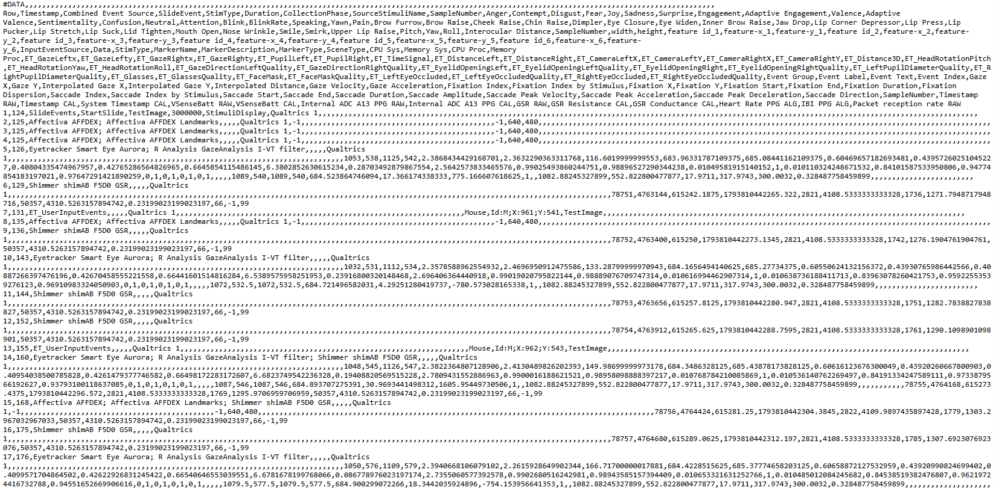

# User Guide

#### Our Data

The CAB Lab collects a combination of survey-based and physiological sensor data to provide researchers with powerful insights on human behavior. We frequently utilize Eye Tracking sensors, Facial Expression Analysis software, and Galvanic Skin Response (GSR) sensors to paint this picture.&#x20;



### Eye Tracking

Aurora sensors perform screen-based eye tracking, collecting data on pupil dilation, fixation duration, and blink rate, allowing for extensive visual attention research.​



### Facial Expression Analysis

Affectiva software collects data on facial expressions, body language, and gestures to gauge human cognitive and emotional states in various contexts.​



### Galvanic Skin Response (GSR)

Shimmer3R GSR+ sensors measure skin conductivity in sweat glands on the hand. These sensors aid in depicting relationships between unconscious arousal and behavior.​



Admittedly, the raw data we collect can be tricky to make sense of...

<figure><figcaption><p>Raw data collected from eye tracking sensors, facial expression analysis software, and GSR sensors</p></figcaption></figure>

...but that's where our custom Python library comes into play!

#### Installing the CBACABLab Library

To use our library, you'll need to install it like any other:

```python
#install using pip
pip install CBACABLab

#install using conda
conda install -c tazzben CBACABLab
```

If you don't yet have Python installed, we recommend installing Anaconda, which is a open-source distribution of Python that includes useful packages for data analysis. You can download Anaconda from [here](https://www.anaconda.com/products/distribution). We also recommend you install Microsoft [Visual Studio Code](https://code.visualstudio.com/) to work with notebook files.&#x20;

#### Primary Uses

The CBACABLab library is designed to help researchers transform raw data into meaningful insights. We don't require users to have any prior experience with data cleaning or econometrics— in fact, that's precisely why this tool exists!

We want to make the data analysis process as seamless as possible. Explore how you can use this library to minimize your time spent on analysis:

<table data-view="cards"><thead><tr><th></th><th></th><th data-hidden data-card-cover data-type="files"></th></tr></thead><tbody><tr><td><h4>Step 1: Designing Your Survey</h4></td><td><p><mark style="color:$primary;">Under construction</mark></p><p>Learn how to configure your Qualtrics survey to ensure smooth parsing later on.</p></td><td><a href=".gitbook/assets/design-survey.jpg">design-survey.jpg</a></td></tr><tr><td><h4>Step 2: Uploading Your Data     </h4></td><td><p><mark style="color:$primary;">Under construction</mark></p><p>Learn how to upload your raw iMotions and Qualtrics data.</p></td><td><a href=".gitbook/assets/upload-data.jpg">upload-data.jpg</a></td></tr><tr><td><h4>Step 3: Creating Visualizations </h4></td><td><p><mark style="color:$primary;">Under construction</mark></p><p>Learn about the functions working behind the scenes to create the visuals you value most.</p></td><td><a href=".gitbook/assets/create-visuals.jpg">create-visuals.jpg</a></td></tr></tbody></table>
